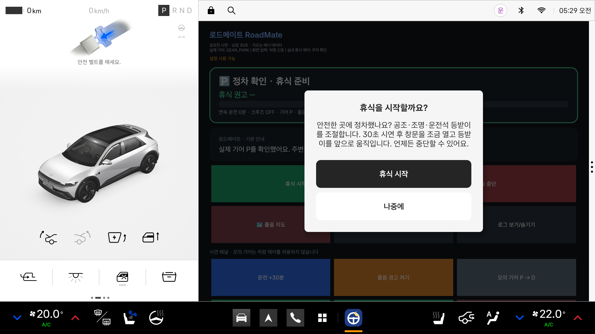

# RoadMate · 로드메이트

운전자가 “쉬고 싶어”라고 하면 쉼터 경로 안내를 요청하고, 주차 후에는 운전자의 승인을 받아 휴식 환경을 준비하는 **Pleos Connect 차량용 Android 앱**입니다.

현대자동차그룹 차량용 앱 개발 공모전에 참여한 3인 팀 프로젝트입니다. 팀의 0.2.1 소스와 에뮬레이터 검증 결과를 담은 개인 포트폴리오입니다. [팀 저장소 0.2.1 기준 커밋](https://github.com/PJJ0337/RoadMate/tree/f4d8cd19ae199f456e7784404cd4569b92857c5d) · [시연 영상 2분 20초 · MP4 다운로드](https://github.com/SEONGBINJEON/RoadMate/releases/download/demo-0.2.1/RoadMate-demo.mp4)



## 운전 중 안내에서 주차 후 휴식까지

1. 운전 시간과 차량 신호에 따라 앱이 휴식을 제안합니다. 운전자가 쉬겠다고 응답하면 예시 쉼터를 골라 차량 내비에 경로를 요청합니다.
2. 실제 Gear SDK의 P 신호와 운전자의 승인이 모두 들어오면 파워냅을 시작합니다. 모의 기어 입력은 실제 주차를 대신할 수 없습니다.
3. 휴식 중에는 지원되는 공조·조명·시트를 조절합니다. 사용자가 중단하거나 P에서 벗어나면 예약된 휴식 명령을 중단합니다. 이미 바뀐 실내 설정은 운전자가 확인해야 합니다.

| 설계에서 다룬 문제 | 구현 |
|---|---|
| 시연 입력이 차량 제어 조건에 섞이는 문제 | [ParkingGate](app/src/main/java/com/roadmate/app/core/ParkingGate.kt)가 실제 기어와 모의 입력을 구분하고 [RoadMateBrain](app/src/main/java/com/roadmate/app/core/RoadMateBrain.kt)이 승인·취소 등 상태 전이를 결정합니다. |
| 운전 중 설정 조작 | [UxRestrictionMonitor](app/src/main/java/com/roadmate/app/car/UxRestrictionMonitor.kt)가 플랫폼 정책을 구독합니다. NO_SETUP이거나 정책을 확인할 수 없으면 설정 화면을 숨깁니다. [D 상태 화면](docs/screenshots/D-locked.png) |
| AI 응답이 늦거나 운전자가 동의를 거부한 경우 | 기본 안내 대본을 사용합니다. [ResponseGate](app/src/main/java/com/roadmate/app/core/ResponseGate.kt)는 대화 상태가 바뀐 뒤 도착한 응답을 무효화합니다. 외부 AI는 대화문 생성에만 사용합니다. |

## 빌드와 테스트

JDK 21, Android SDK Platform 35, Build Tools 35.0.0을 사용합니다. Gradle Wrapper 8.10.2가 포함돼 있습니다. Android Studio에서 이 폴더를 열고 SDK 경로를 설정한 뒤 실행하세요. 첫 빌드에서는 Google Maven, Maven Central, Pleos SDK 저장소에 접근해야 합니다.

Windows에서는 처음부터 `C:\dev\RoadMate`처럼 한글이 없는 경로에 내려받아 실행하세요. 한글이 포함된 폴더에서는 Gradle이 테스트 클래스를 찾지 못하는 문제가 확인됐습니다.

```powershell
.\gradlew.bat :app:testDebugUnitTest :app:assembleRelease
```

macOS와 Linux에서는 `./gradlew`를 사용합니다. APK는 `app/build/outputs/apk/release/app-release.apk`에 생성됩니다. 이 프로젝트의 release 설정은 시연용 debug 인증서로 서명합니다. 차량 연동 시연에는 Pleos Connect 2.1.0 에뮬레이터(API 34)와 Virtual Console이 필요합니다. [에뮬레이터 설정과 시연 순서](docs/demo.md)

API 키 없이 기본 대화 흐름을 실행할 수 있습니다. 외부 AI를 시험할 때만 로컬 `local.properties`에 개발용 `GEMINI_API_KEY` 또는 릴리스용 `GEMINI_API_KEY_RELEASE`를 설정하세요. 외부 AI 사용에 동의하면 최근 대화 텍스트와 운전 시간·시각·권고 지표를 전송합니다. 일부 개인정보 패턴을 가리지만 이름·주소가 발화에 남을 수 있습니다.

## 검증 범위와 다음 개발 과제

- **핵심 로직** — 단위 테스트 43개가 주차 신호 구분, 취소 후 상태, 늦은 AI 응답 처리 등을 검사합니다. [테스트 코드](app/src/test/java/com/roadmate/app/core)
- **Pleos 에뮬레이터** — 0.2.1 최종 APK에서 P 수신 → 승인 → 휴식 시작 → 중단 후 복귀를 확인했습니다. 같은 버전의 UX 연동 빌드에서는 D 상태의 설정 잠금과 P 복귀를 확인했습니다. [휴식 중 화면](docs/screenshots/nap.png)
- **시연 조건** — 초기 구간의 운전 시간·기어·지도에는 모의 데이터를 썼고 운전자 음성은 AI로 재연했습니다. 영상은 대기 구간을 편집했고, 0.2.1의 시연용 휴식 타이머는 30초입니다.
- **다음 단계** — 현재 예시 쉼터 세 곳의 직선거리를 비교하는 방식을 진행 방향과 도로 접근성을 반영한 선택으로 개선하고, 주행 중 음성과 내비 전환 후 복구를 검증할 계획입니다. 실차 동작·졸음 판별 정확도·사고 감소 효과는 검증 전입니다.
